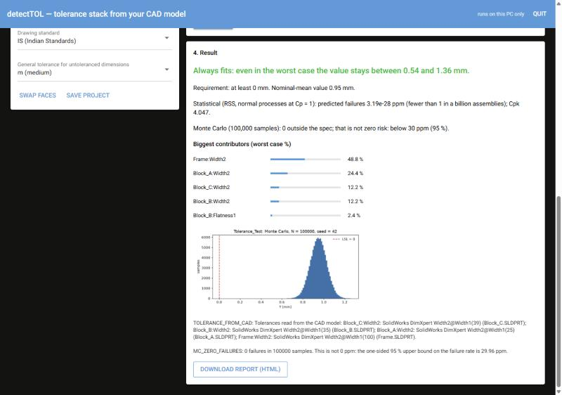
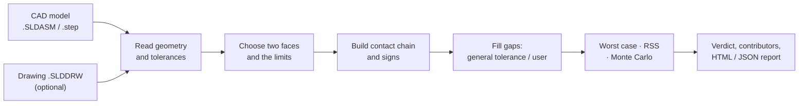
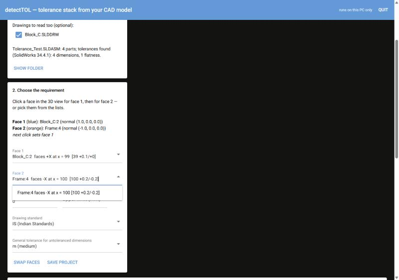
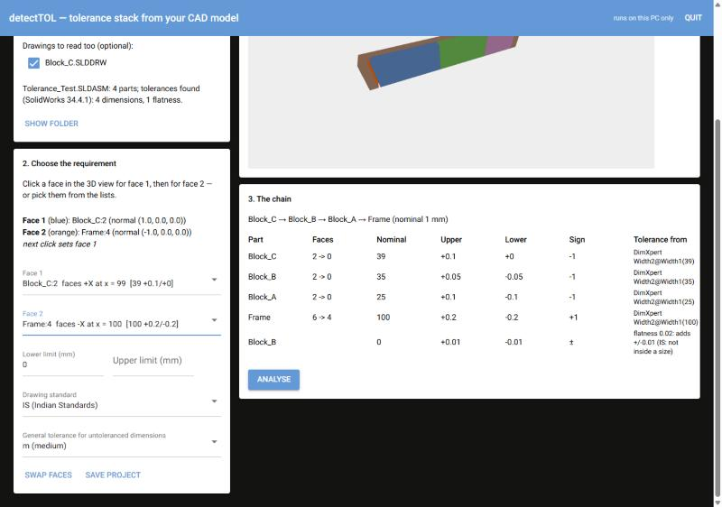

<div align="center">

# detectTOL

**Mechanical tolerance stack-up analysis, straight from your CAD model.**

Worst case · RSS · Monte Carlo · GD&T (subset) · SolidWorks & STEP AP242 · IS / ISO / ASME

[](https://github.com/Chirag860/detectTOL/actions/workflows/ci.yml)
[](LICENSE)


</div>

---

## Overview

Every manufactured part deviates from its nominal size within its tolerance. In an
assembly those deviations add up, and a functional requirement such as a gap, a
clearance or an alignment may no longer hold.

**detectTOL answers one question: _will this assembly meet its requirement once every
part varies within its tolerance, and if not, which tolerances are responsible?_**

It reads the tolerances already defined in your CAD model (SolidWorks DimXpert,
SolidWorks drawings, or semantic PMI in STEP AP242). It finds the chain of contacting
parts between the two faces you choose and reports the result in plain engineering
terms. Alongside the verdict you get the predicted failure rate and the contribution
of each tolerance, and every tolerance is traced back to where it came from.

It is a free, transparent alternative to spreadsheet stack-ups and to expensive
commercial tools. All the math is open, deterministic and independently verified.

<p align="center">
  
</p>

## Key features

| | |
|---|---|
| **Three analysis methods** | Worst case, RSS (root sum square) and seeded Monte Carlo, run side by side on the same stack. |
| **Reads your CAD directly** | SolidWorks assemblies (`.SLDASM`) through the SolidWorks API, plus drawings (`.SLDDRW`) and STEP AP242 files with semantic PMI. Files are opened read-only. |
| **Automatic chain building** | Finds which parts touch, builds the dimension loop between the two faces you choose and works out each sign itself. If the chain is ambiguous it stops with an explanation rather than guessing. |
| **Point-and-click app** | A local browser app with a 3D view: pick two faces, review the chain, get a verdict. No command line needed. |
| **Traceable tolerances** | Every dimension shows its source: DimXpert, drawing, general tolerance or user entry. |
| **Drawing standards** | IS (Indian Standards), ISO and ASME rules, including the independency principle (IS 12160 / ISO 8015) versus ASME Rule #1. General tolerances to IS 2102 / ISO 2768 (f, m, c, v). Fit classes to IS 919 / ISO 286. |
| **Meaningful statistics** | Failure rate in ppm, Cpk, contribution percentages and Monte Carlo confidence bounds. A result of "0 failures" is reported as an upper bound, never as zero. |
| **2D / 3D vector loops** | Nonlinear stacks with angles, defined in YAML, for cases a 1D chain cannot capture. |
| **Professional reports** | HTML, Markdown and JSON (versioned schema) reports with a Monte Carlo histogram, ready for design reviews. |
| **Scriptable** | A full CLI and Python API for automation, batch studies and CI pipelines. |

## How it works



---

## Installation

### Option A: Windows installer (recommended for engineers)

Requirements: Windows 10 or 11. To read SolidWorks files you also need a licensed
SolidWorks on the same PC (tested with SOLIDWORKS 2026). No administrator rights are
needed.

1. Download the repository (**Code → Download ZIP**, then unzip) or clone it:
   ```bash
   git clone https://github.com/Chirag860/detectTOL.git
   ```
2. Open the `installer` folder and double-click **`install_detectTOL.bat`**.
3. If conda is not installed, the installer offers to install
   [Miniforge](https://conda-forge.org/download/), a free Python distribution. Answer `y`.
4. Setup takes 5–15 minutes the first time. When it finishes, a **detectTOL** shortcut
   appears on the Desktop and in the Start menu.

To uninstall, run `installer\uninstall_detectTOL.bat`.

### Option B: Conda environment (developers, full CAD support)

```bash
conda env create -f environment.yml
conda activate detecttol
conda install -c conda-forge nicegui pywin32   # app + SolidWorks (Windows)
pytest
```

### Option C: pip (core engine and CLI only)

The analysis engine, the YAML workflow and the reports have no CAD dependency and run
on any OS:

```bash
pip install -e ".[dev]"
```

Optional extras: `.[app]` for the browser app and `.[solidworks]` for SolidWorks
access (Windows). Reading STEP files needs `pythonocc-core`, which is available
through conda only.

---

## Usage

### 1. The app (no command line needed)

Double-click the **detectTOL** shortcut, or run:

```bash
detecttol app
```

Your browser opens at `http://127.0.0.1:8765`. The app runs only on your PC, and no
data leaves it.

| Step | What you do |
|---|---|
| **1. Open the model** | Browse to the folder, tick any drawings to include, and click the `.SLDASM` (read through SolidWorks in about 20 s) or `.step` file. |
| **2. Define the requirement** | Click face 1 and face 2 in the 3D view, or pick them from the lists. Set the lower and upper limits, the drawing standard (IS / ISO / ASME) and the general tolerance class. |
| **3. Review the chain** | Each dimension in the loop is listed with its sign and tolerance source. Dimensions without a tolerance are highlighted and can be filled in. |
| **4. Analyse** | Get a plain-language verdict, worst case, RSS and Monte Carlo results, the biggest contributors, a histogram and a downloadable HTML report. |

**Save project** writes `<model>.dtol` next to the model. When you reopen it, the
model is read again, so later CAD changes are picked up.

<p align="center">
  
  
</p>

The [user guide](docs/USER_GUIDE.md) walks through each step and shows how to add
DimXpert tolerances in SolidWorks. It also has a troubleshooting table.

### 2. Command line: directly from CAD

List the faces of a model and the tolerances found on them:

```bash
detecttol faces Tolerance_Test.SLDASM --drawing Block_C.SLDDRW
```

Analyse the distance between two faces, using the face names from the step above:

```bash
detecttol analyze-cad Tolerance_Test.SLDASM --drawing Block_C.SLDDRW --from Block_C:2 --to Frame:4 --standard is --general m --format html --out out
```

| Option | Meaning |
|---|---|
| `--from`, `--to` | The two faces of the requirement, written as `PART:FACE` |
| `--lsl`, `--usl` | Lower and upper spec limits in mm (default: gap ≥ 0) |
| `--standard` | `asme`, `iso` or `is` |
| `--general` | General tolerance class `f` / `m` / `c` / `v`, applied to dimensions without a tolerance |
| `--samples`, `--seed` | Monte Carlo sample count (default 100 000) and seed (default 42) |
| `--format`, `--out` | `md`, `html` or `json`, and the output directory |

The same command accepts a STEP AP242 file with semantic PMI, so models from other
CAD systems work too. Example files are in [`examples/solidworks/`](examples/solidworks).

### 3. Command line: YAML stack definition

For hand-defined stacks, or for 2D and 3D vector loops, describe the stack in YAML:

```yaml
schema_version: 1
units: mm
name: plate_stack_in_slot
standard: iso            # asme | iso | is
general_tolerance: m     # optional IS 2102 / ISO 2768 class
requirement:
  description: gap between top plate and slot ceiling
  lsl: 0.0
contributors:
  - { id: slot_depth, nominal: 50.00, upper_tol: 0.10, lower_tol: -0.10, sensitivity: 1 }
  - { id: plate_1,    nominal: 16.60, upper_tol: 0.05, lower_tol: -0.05, sensitivity: -1 }
  - { id: plate_2,    nominal: 16.60, upper_tol: 0.05, lower_tol: -0.05, sensitivity: -1 }
  - { id: plate_3,    nominal: 16.60, upper_tol: 0.05, lower_tol: -0.05, sensitivity: -1 }
analysis:
  methods: [worst_case, rss, monte_carlo]
  monte_carlo: { n: 100000, seed: 42 }
```

```bash
detecttol analyze examples/golden_case_a.yaml --format html --out out
```

Result for this example:

| Method | Result | Meets spec (gap ≥ 0) |
|---|---|---|
| Worst case | gap from −0.05 to 0.45 mm | No |
| RSS | σ = 0.0441 mm, Cpk = 1.51, 2.9 ppm predicted failures | Yes |
| Monte Carlo (N = 100 000) | 0 failures observed (< 30 ppm, 95 % upper bound) | Yes |
| Top contributor | `slot_depth`, 57 % of the RSS variance | |

More examples, including asymmetric tolerances, uniform distributions, fit classes and
2D/3D loops, are in [`examples/`](examples).

Look up a fit class or a general tolerance:

```bash
detecttol limits 25 H7
```

```bash
detecttol limits 25 general --general m
```

### 4. Python API

```python
from detecttol import analyze
from detecttol.io import load_stack

result = analyze(load_stack("examples/golden_case_a.yaml"))
print(result.rss.p_fail_ppm)
```

---

## Drawing standards

| Standard | Flatness on a sized face | Notes |
|---|---|---|
| **IS** (Indian Standards) | Adds ±t/2 to the stack (independency principle, IS 12160) unless the size is marked Ⓔ | Same rules as ISO |
| **ISO** | Adds ±t/2 (ISO 8015) unless marked Ⓔ (`envelope: true`) | |
| **ASME** | Inside the size limits (Rule #1, Y14.5) | Assumed when no standard is given; the report warns wherever this changes a result |

Plain ± stacks give identical results under all three standards.

## Verification and quality

Engineers use these results to make manufacturing decisions, so correctness is treated
as a first-class requirement.

- **Hand-derived golden values.** Every expected number in the test suite is derived
  step by step in the test's docstring.
- **Independent cross-check.** [`validation/verify_golden.py`](validation/verify_golden.py)
  recomputes all 86 golden values by a different numerical route (numerical integration,
  explicit rotation matrices, finite differences). It does not import the library and
  runs in CI.
- **Deterministic.** Every random process takes an explicit seed, so the same input
  always gives the same output.
- **Strict inputs.** Units are millimetres. Missing or unknown units are rejected.
- **Documented assumptions.** Every modelling choice (distributions, sigma convention,
  GD&T interpretation, sign convention) is recorded in
  [docs/ASSUMPTIONS.md](docs/ASSUMPTIONS.md) with its reasoning.
- **Continuous integration.** Tests, linting (ruff) and type checking (mypy, strict) run
  on Windows, Linux and macOS with Python 3.11 and 3.12.

## Scope and current limitations

detectTOL tells you clearly what it does not cover. In the current release:

- CAD-driven chains work along **one straight direction**, through parts that touch on
  **flat faces**. Angles, pins in holes and clearance fits are not yet read from CAD.
  2D and 3D loops can be defined in YAML.
- **Flatness** is the only geometric tolerance used in the stack. Position and profile
  are read and listed, but not applied.
- IS 919 / ISO 286 fit classes are supported for **H, h, JS and js** only, and the table
  has not yet been checked against a printed copy. Reports that use it say so.
- The GD&T conversions have not yet been reviewed against the full text of ASME Y14.5.
- Assemblies with rotated components, or with the same part used more than once, are
  not yet supported or tested.
- SolidWorks without the MBD add-in cannot export STEP files with tolerances. For
  SolidWorks models, use the `.SLDASM` route.

> **Disclaimer:** detectTOL is an engineering aid, not a certified tool. A responsible
> engineer must review the chain, the tolerances and the results before using them for
> design or manufacturing decisions.

## Project structure

```text
detectTOL/
├── src/detecttol/
│   ├── core/         # stack math: linear, 2D/3D loops, Monte Carlo (no CAD dependency)
│   ├── gdt/          # GD&T subset: flatness, bonus tolerance, Rule #1 / ISO 8015
│   ├── standards/    # IS 2102 / ISO 2768 general tolerances, IS 919 / ISO 286 fits
│   ├── cad/          # STEP AP242 reader, PMI, contact detection, chain building
│   ├── solidworks/   # SolidWorks reader (DimXpert, drawings) via COM
│   ├── report/       # Markdown / HTML / JSON reports, histograms, JSON schemas
│   ├── io/           # YAML stack loader
│   ├── cli/          # `detecttol` command line
│   └── app/          # local browser app (`detecttol app`)
├── examples/         # YAML stacks, STEP assemblies, SolidWorks test assembly
├── installer/        # one-click Windows installer and uninstaller
├── validation/       # independent recomputation of golden values
├── tests/            # unit, property-based and golden-value tests
└── docs/             # user guide, assumptions, decisions, phase reports
```

## Documentation

| Document | Contents |
|---|---|
| [User guide](docs/USER_GUIDE.md) | Installation, adding tolerances in SolidWorks, using the app, troubleshooting |
| [SolidWorks test assembly](docs/guides/solidworks-test-assembly.md) | Step-by-step example model |
| [Assumptions](docs/ASSUMPTIONS.md) | Every modelling assumption, with its reasoning |
| [Design decisions](docs/DECISIONS.md) | Design decisions and their status |
| [Phase reports](docs/reports/) | Development and verification record for each phase |

## Development

```bash
conda activate detecttol
pytest                      # full test suite
ruff check . && ruff format --check .
mypy                        # strict type checking of the core
python validation/verify_golden.py
```

The SolidWorks integration tests need a licensed SolidWorks and run only when
`DETECTTOL_SOLIDWORKS=1` is set.

## Reporting issues

If a model does not analyse correctly or a result looks wrong, please
[open an issue](https://github.com/Chirag860/detectTOL/issues). Include the detectTOL
version (`detecttol --version`), the error message or report, and, if you can share
it, a minimal model that reproduces the problem.

## License

Released under the [Apache License 2.0](LICENSE).
