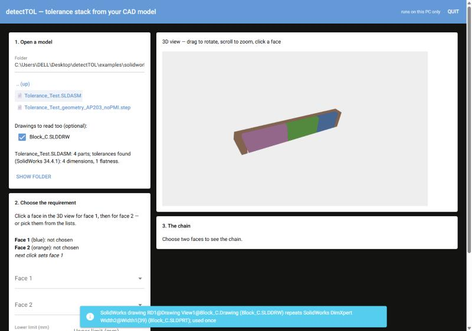
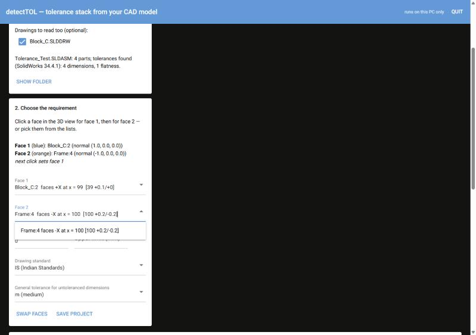
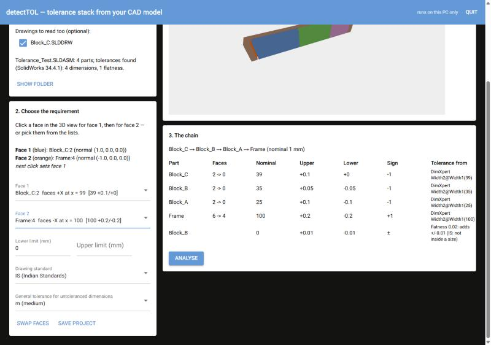
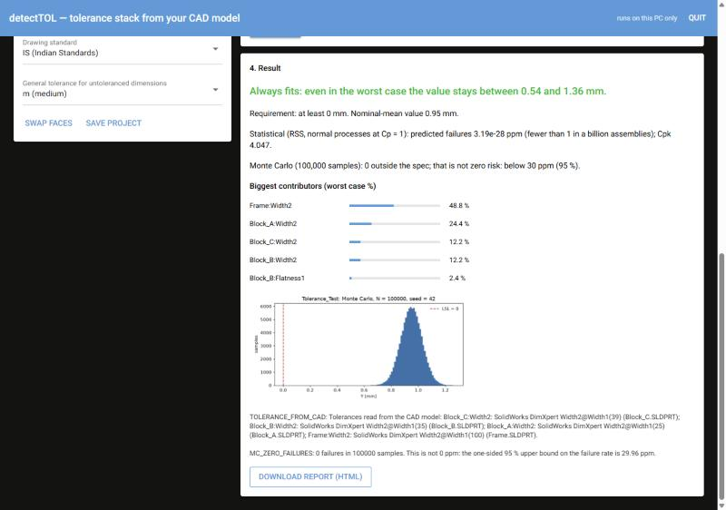

# detectTOL user guide

detectTOL tells you whether a gap (or any distance between two faces) in your
assembly stays within its limits once every part varies inside its tolerance.
It reads the tolerances you already put in your CAD model. No programming, no
spreadsheets.

> Read the results like any engineering tool: check the chain and the tolerances it
> shows before you trust a number. Every tolerance says where it came from.

## 1. Install (once)

You need Windows 10/11. For SolidWorks models you also need SolidWorks installed and
licensed on the same PC (tested with SOLIDWORKS 2026).

1. Get the detectTOL folder (from GitHub: *Code → Download ZIP*, then unzip; or `git clone`).
2. Open the folder `installer` and double-click **`install_detectTOL.bat`**.
3. If you have no conda yet, it asks whether to download **Miniforge**, a free Python
   distribution. Answer `y`.
4. It takes 5–15 minutes the first time. It ends with *Done* and a **detectTOL**
   icon on your Desktop and in the Start menu.

To remove it later, run `installer\uninstall_detectTOL.bat`.

## 2. Put the tolerances in your SolidWorks model

detectTOL reads **DimXpert** tolerances, which every SolidWorks edition has. You
can also add toleranced dimensions in a **drawing** (.SLDDRW).

In each part:

1. Open the **MBD Dimension** tab. If it's missing, right-click a CommandManager tab
   and choose *MBD Dimension*.
2. **Size Dimension**: click a face. DimXpert finds the opposite face (a *width*).
   Enter the tolerance (Bilateral, e.g. +0.10 / −0.10).
3. Or **Location Dimension**: the distance between two faces.
4. Optional: **Geometric Tolerance → Flatness** on a face.
5. Save the part.

A step-by-step example with a small test assembly is in
[guides/solidworks-test-assembly.md](guides/solidworks-test-assembly.md).

Dimensions **without** a tolerance are fine: the app fills them from your drawing's
general tolerance class (IS 2102 / ISO 2768: f, m, c or v), or you type them in.

## 3. Use the app

Double-click **detectTOL**. Your browser opens the app at `http://127.0.0.1:8765`.
It runs on your PC only; nothing is uploaded.

### Step 1: open the model

- Type or browse to the folder (📁 opens a folder).
- Tick any **drawings** you want read too.
- Click the **.SLDASM**. SolidWorks reads it in the background, which takes about
  20 s; your files are opened read-only and never changed. A `.step` file works too,
  for other CAD tools.
- The line under the files says what was found, e.g. *4 parts; tolerances found
  (SolidWorks 34.4.1): 4 dimensions, 1 flatness*.

### Step 2: choose the requirement

- **Face 1** and **Face 2** are the two faces whose distance matters, e.g. the end of
  the last block and the wall it must not touch. Choose them either way:
  - **click** them in the 3D view: drag to rotate, scroll to zoom. Face 1 turns
    blue, face 2 orange;
  - or **pick** them in the lists. Each entry shows the direction, the position and
    any tolerance on that face, e.g. `Block_C:2 faces +X at x = 99 [39 +0.1/+0]`.
    Typing the name (e.g. `Frame:4`) chooses it directly.

  Faces across a small gap are often hidden in 3D; use the lists for those.
- **Lower / upper limit**: e.g. lower limit 0 for "the gap must not close".
- **Drawing standard**:
  - **IS** (Indian Standards) and **ISO** count a flatness on top of the size;
  - **ASME** treats it as inside the size (Rule #1).
- **General tolerance**: the class from your title block, used for dimensions
  without a tolerance.

### Step 3: check the chain

The app finds which parts touch and builds the chain between your two faces itself.
Every row shows:

- **Part**: the part the dimension belongs to.
- **Upper / Lower**: the tolerance.
- **Sign**: +1 if a larger size makes the gap larger, −1 if it makes it smaller.
- **Tolerance from**: where the tolerance came from.

| Row colour | Meaning |
|---|---|
| white | read from your model (DimXpert / drawing / STEP) |
| light yellow | general tolerance (IS 2102); you can type over it |
| blue | typed by you |
| yellow, empty | no tolerance anywhere: type one before you can analyse |

### Step 4: the result

| What | How to read it |
|---|---|
| **Verdict** (green / orange / red) | *Always fits*: even with every part at its worst limit. *Can fail in the worst case*: possible, so look at the statistics. *Does not fit even at nominal size*: the design itself is wrong. |
| **Statistical (RSS)** | Predicted fraction of bad assemblies, assuming normal, centred processes (Cp = 1). "1 in 28 million" means rare, not impossible. |
| **Monte Carlo** | 100 000 random assemblies. *0 outside* still means "below about 30 ppm", not zero. |
| **Biggest contributors** | Which tolerances matter most. Tighten the top one first. |
| **Download report (HTML)** | The full report with every number, for your records or a review. |

**Save project** stores your choices in `<model>.dtol` next to the model. Open it the
same way as a model; the model is re-read, so changes in CAD are picked up.

**Quit** (top right) closes the app. It also closes itself about a minute after you
close its browser tab.

## 4. When something goes wrong

| You see | Do this |
|---|---|
| *Could not open … SolidWorks could not be started* | Check that SolidWorks starts normally and is licensed. Close any SolidWorks dialog that is waiting for an answer. |
| *no path of planar contacts …* | The two faces are not connected through parts that touch face to face. Check the mates; parts must really touch (no gap) along the measuring direction. |
| *N possible paths …* | Two load paths: the assembly is over-constrained in that direction. detectTOL will not guess which one is real. |
| *… ways to combine its dimensions* | A part is dimensioned two different ways between the same faces. Dimension the faces in the chain directly. |
| *part '…' is used more than once* | Not supported yet. Make the instances separate part files for now. |
| A face you need is hidden in 3D | Pick it from the list. |
| The page says *connection lost* | The app was closed (Quit or idle). Double-click detectTOL again. |

## 5. Limits (what detectTOL does not do yet)

- One straight direction only, with parts that touch on flat faces. No angles, no
  pins in holes, no clearance fits.
- Flatness is the only geometric tolerance used. Position and profile are listed,
  but not used.
- IS 919 / ISO 286 fit classes only for H, h, JS and js, and **that table has not
  yet been checked against a printed copy** (the report says so).
- Rotated parts in an assembly are not yet tested.
- Not a certified tool: results must be checked by a responsible engineer.

Questions or a model that doesn't work: see the README for how to report it.
